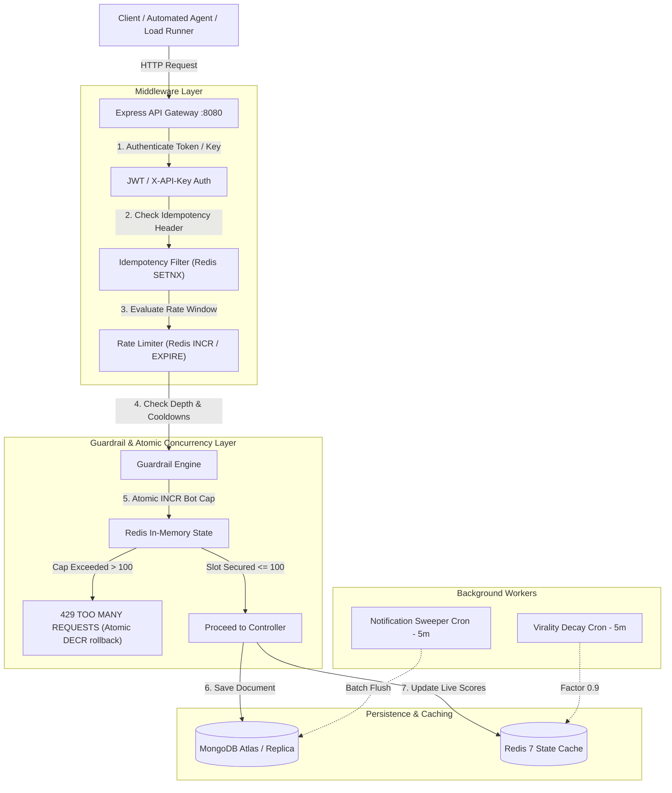

# 🛡️ Guardrails MERN — Anti-Abuse, Rate-Limiting & Concurrency Engine


[](https://github.com/LAKSHYA-NIGAM/guardrails-api/actions/workflows/ci.yml)
[](https://nodejs.org/)
[](https://redis.io/)
[](LICENSE)

A **production-minded distributed anti-abuse and atomic concurrency engine** built on the MERN stack (Node.js, Express, React, MongoDB) and backed by **Redis 7 (`ioredis`)**.

Designed to demonstrate how high-scale platforms (like Reddit, Twitter, and Stripe) enforce sub-millisecond rate limiting, anti-spam throttling, duplicate write prevention (idempotency), nested reply depth limits, virality scoring with decay, and intelligent notification batching without distributed race conditions or database lock exhaustion.

---

## 📋 Table of Contents

1. [Executive Summary & Problem Statement](#-executive-summary--problem-statement)
2. [High-Level Architecture & Request Lifecycle](#-high-level-architecture--request-lifecycle)
3. [Core Engineering Solutions & Redis Primitives](#-core-engineering-solutions--redis-primitives)
4. [Tech Stack & Dependencies](#-tech-stack--dependencies)
5. [Project Structure](#-project-structure)
6. [Step-by-Step Getting Started & User Walkthrough](#-step-by-step-getting-started--user-walkthrough)
7. [API Reference & Authentication](#-api-reference--authentication)
8. [Interactive Dashboard Walkthrough](#-interactive-dashboard-walkthrough)
9. [Automated Test Suite & Concurrency Verification](#-automated-test-suite--concurrency-verification)
10. [Load Testing Suite (k6 & Standalone Runner)](#-load-testing-suite-k6--standalone-runner)
11. [Senior Engineering Interview Defense Guide](#-senior-engineering-interview-defense-guide)

---

## 🎯 Executive Summary & Problem Statement

In high-throughput distributed applications, naive database writes face critical failure modes:

| Challenge | Naive Approach | Consequence | Guardrails Solution |
|---|---|---|---|
| **High-Volume Bot Spikes** | `SELECT count(*) WHERE ...` then `INSERT` | **Distributed Race Condition**: 120+ requests read count < 100 concurrently; all 120 commit. DB connection exhaustion. | **Redis `INCR` Guard**: Atomic single-threaded counter executed *before* database access. Exactly 100 succeed; 20 throttled with HTTP 429. |
| **API Spam & Denial of Service** | Unrestricted endpoints or in-memory array | Memory leaks, node process crashes, cascading database failures under write bursts. | **Fixed-Window Rate Limiter**: 20 req/min per user/IP using Redis `INCR` + `EXPIRE` with standard `Retry-After` headers. |
| **Double Clicks & Network Retries** | Blind `INSERT` on write endpoints | Duplicate charges, ghost comments, duplicate database records. | **Idempotency Cache**: Client `Idempotency-Key` stored via Redis `SET key data EX 120 NX` returning cached replay (`X-Idempotent-Replay`). |
| **Spam Storms on Creators** | Direct push notification on every comment | Notification fatigue, mobile push rate limits exceeded. | **Smart Batching Sweeper**: Instant delivery for first alert; subsequent alerts grouped in Redis Lists over 15-min cooldown windows. |
| **Redis Cache Outage** | Hard application crashes | Complete service downtime. | **Graceful Degradation & Cold Sync**: Fail-safe fallbacks + cold-start counter reconciliation from MongoDB on startup. |

---

## 🏗️ High-Level Architecture & Request Lifecycle



---

## ⚡ Core Engineering Solutions & Redis Primitives

### 1. Atomic Anti-Spam Bot Cap (`INCR` / `DECR`)
- **Key Pattern**: `post:<postId>:bot_count`
- **Mechanism**: Before saving any comment authored by a bot, the server executes `redis.incr(key)`. If the resulting integer exceeds `100`, the server immediately executes `redis.decr(key)` and throws a `429 Too Many Requests` error.
- **Why It Works**: Redis executes commands in a single-threaded event loop. Two requests hitting the server at the exact same microsecond will be queued sequentially. Race conditions are mathematically prevented without distributed locks (`Redlock`) or heavy SQL row locking (`SELECT FOR UPDATE`).

### 2. General Fixed-Window Rate Limiter
- **Key Pattern**: `ratelimit:<identifier>:<windowTimestamp>`
- **Identifier Strategy**: Authenticated User ID (`user:<id>`), Authenticated Bot ID (`bot:<id>`), or Client IP (`ip:<address>`).
- **Mechanism**: Calculates current 60-second window epoch. Uses `redis.incr(key)`. On initial increment (`count === 1`), sets `EXPIRE key 62`.
- **Response Headers**: Returns RFC-compliant `X-RateLimit-Limit`, `X-RateLimit-Remaining`, `X-RateLimit-Reset`, and `Retry-After`.

### 3. Client-Supplied Idempotency (`SET ... NX`)
- **Key Pattern**: `idempotency:<clientKey>`
- **Mechanism**: On write requests (`POST /posts`, `/comments`, `/likes`), the client passes `Idempotency-Key: <uuid>`. The server executes `redis.set(key, JSON.stringify(result), 'EX', 120, 'NX')`. If the key exists, the cached payload is returned with header `X-Idempotent-Replay: true`.

### 4. Interaction Cooldowns
- **Key Pattern**: `cooldown:bot:<botId>:user:<userId>`
- **Mechanism**: When a bot comments on a human user's post, Redis stores a key with a 10-minute TTL (`EX 600`). Any subsequent attempt by the same bot on that user's content within 10 minutes is blocked with `429 Interaction throttle active`.

### 5. Virality Scoring & Exponential Time-Decay
- **Key Pattern**: `post:<postId>:virality`
- **Weights**: Human Like = **+20**, Human Comment = **+50**, Bot Interaction = **+1**.
- **Scheduled Decay**: A background scheduler fires every 5 minutes (`300000ms`), multiplying all active scores by `0.9` (10% decay) to ensure older posts naturally yield top spots to fresh engagement.

### 7. PII Masking & Redaction Engine (`piiGuardrail.js`)
- **Real-Time Data Sanitization**: Inspects incoming payload streams for high-risk PII including RFC 5322 email patterns, E.164 phone numbers, US SSNs, and payment card numbers.
- **Luhn Modulo-10 Checksum Validation**: Unlike naive 16-digit regex scrapers, the engine validates ISO/IEC 7812 credit card numbers against the Luhn algorithm before masking with `[CREDIT_CARD_REDACTED]`, eliminating false positives on benign numeric strings.

### 8. Token Bucket Traffic Shaper (`tokenBucketGuardrail.js`)
- **Burst-Tolerant Rate Limiting**: Implements a continuous-fill token bucket algorithm allowing clients to consume bursts up to bucket capacity while enforcing smooth steady-state replenishment rates.
- **Dynamic Cost Accounting**: Supports variable token weights per request (e.g. lightweight reads consume 1 token, heavy LLM/concurrency evaluations consume 5 tokens). Isolated per client identity.

### 6. Smart Notification Batching & Flush
- **Key Patterns**:
  - Cooldown Lock: `user:<userId>:notif_cooldown` (TTL 15 min)
  - Pending Notification Queue: `user:<userId>:pending_notifs` (Redis List `RPUSH`)
  - Active Users Index: `users:pending_notif_users` (Redis Set `SADD`)
- **Behavior**: If the cooldown key does not exist, the alert is sent immediately and the 15-minute lock is acquired. If locked, incoming alerts are queued in the Redis List. A sweeper daemon periodically flushes all pending batches.

---

## 🛠️ Tech Stack & Dependencies

### Backend
- **Runtime**: Node.js v20+ (ES Modules)
- **Framework**: Express.js 4.x
- **Database ODM**: Mongoose 8.x (MongoDB 7 / MongoDB Atlas)
- **Redis Client**: `ioredis` (Full connection lifecycle management, reconnect backoff)
- **Security & Auth**: `jsonwebtoken` (JWT issuance & verification), `bcryptjs` (salted password hashing)
- **Testing**: Node.js Native Test Runner (`node:test`, `node:assert`)

### Frontend
- **Framework**: React 18
- **Build Tool**: Vite 6
- **Styling**: Tailwind CSS (Linear/Vercel-inspired minimal dark theme: `#09090b` surfaces, `1px` subtle zinc borders, monochrome icons, sharp corners, zero emojis)
- **Icons**: `lucide-react`

### Load Testing
- **k6**: Standalone Go-based high-concurrency load testing engine (`loadtest/concurrency-test.js`)
- **Custom Node Load Runner**: Pure ES Module concurrent async runner with statistical distribution reporting (`loadtest/load-runner.js`)

---

## 📂 Project Structure

```
guardrails-mern/
├── docker-compose.yml              # Local MongoDB & Redis container definitions
├── loadtest/                       # Performance & Concurrency Load Test Suite
│   ├── package.json
│   ├── concurrency-test.js         # k6 120-VU concurrent burst script
│   └── load-runner.js              # Standalone Node.js load runner (p50/p95/p99)
├── server/                         # Express Backend Microservice
│   ├── package.json
│   ├── .env                        # Environment Configuration
│   ├── src/
│   │   ├── config/
│   │   │   ├── db.js               # MongoDB connection with retry logic
│   │   │   └── redis.js            # ioredis client with event listeners
│   │   ├── models/
│   │   │   ├── Counter.js          # Auto-incrementing sequence generator
│   │   │   ├── User.js             # User model (password hashing, isPremium)
│   │   │   ├── Bot.js              # Bot model (auto-generated apiKey)
│   │   │   ├── Post.js             # Post model
│   │   │   ├── Comment.js          # Comment model (depthLevel, authorType)
│   │   │   └── Like.js             # Like model (compound unique index)
│   │   ├── middleware/
│   │   │   ├── auth.js             # JWT bearer verification
│   │   │   ├── apiKeyAuth.js       # X-API-Key bot authentication
│   │   │   ├── rateLimiter.js      # Fixed-window Redis rate limiter
│   │   │   ├── idempotency.js      # Redis SETNX idempotency filter
│   │   │   └── errorHandler.js     # Standardized JSON error response handler
│   │   ├── services/
│   │   │   ├── guardrailService.js # Concurrency caps, depth, cooldowns
│   │   │   ├── viralityService.js  # Virality scoring and decay
│   │   │   ├── notificationService.js # Batched notification queues
│   │   │   ├── syncService.js      # Cold-start MongoDB-to-Redis synchronizer
│   │   │   ├── postService.js      # Post business logic
│   │   │   ├── commentService.js   # Comment business logic
│   │   │   └── likeService.js      # Like business logic
│   │   ├── controllers/            # Route controllers
│   │   ├── routes/index.js         # Express route definitions
│   │   ├── schedulers/             # Schedulers (decay & notification sweeper)
│   │   └── server.js               # Application bootstrap
│   └── tests/
│       └── guardrails.test.js      # Automated integration & concurrency suite
└── client/                         # React Vite Frontend Application
    ├── package.json
    ├── vite.config.js
    └── src/
        ├── api.js                  # Axios/Fetch API client with Auth headers
        ├── components/
        │   ├── Header.jsx          # Top navigation, status indicator, auth modal
        │   ├── GuardrailsInfo.jsx  # 4 action-oriented testing stat cards
        │   ├── ConcurrencyStudio.jsx # Primary 120-request interactive testing tool
        │   ├── PostCard.jsx        # Live post card with comment & like actions
        │   ├── ViralityLeaderboard.jsx # Top viral posts tabular widget
        │   ├── NotificationCenter.jsx  # Batched notification alerts modal
        │   ├── AuthModal.jsx       # Login, Register & JWT issuance modal
        │   ├── CreatePostModal.jsx # Post publisher modal
        │   └── CreateEntityModal.jsx   # Bot/User creator with API key generation
        └── App.jsx                 # Main application layout
```

---

## 🚀 Step-by-Step Getting Started & User Walkthrough

### 1. Prerequisites
- **Node.js**: v20+ installed
- **Docker**: Docker Desktop (or local MongoDB on `27017` and Redis on `6379`)

### 2. Environment Configuration
Verify `server/.env` contains your database and cache URIs:
```env
PORT=8080
MONGODB_URI=mongodb+srv://<username>:<password>@cluster0.gcdwmfp.mongodb.net/guardrails_db
REDIS_HOST=localhost
REDIS_PORT=6379
JWT_SECRET=guardrails_super_secret_jwt_key_2026
```

### 3. Start Infrastructure (Docker)
```bash
docker-compose up -d
```

### 4. Start Backend Server
```bash
cd server
npm install
npm start
```
*The Express API will boot on `http://localhost:8080`, connect to MongoDB Atlas & Redis, synchronize existing post counters, and start background workers.*

### 5. Start Frontend Client
```bash
cd ../client
npm install
npm run dev
```
*The React Dashboard will open on `http://localhost:3000`.*

---

## 🔑 API Reference & Authentication

### Authentication & Identification Headers
- **User JWT Authentication**: Header `Authorization: Bearer <jwt_token>`
- **Bot API Key Authentication**: Header `X-API-Key: gr_bot_<hex>`
- **Idempotent Requests**: Header `Idempotency-Key: <unique_client_key>`

### Key Routes

| Method | Endpoint | Description | Guardrails Applied |
|---|---|---|---|
| `POST` | `/api/auth/register` | Register new user with username & password | Password hashing |
| `POST` | `/api/auth/login` | Login and receive JWT access token | Rate limited |
| `POST` | `/api/bots` | Register automated bot, returns `apiKey` | Rate limited |
| `POST` | `/api/posts` | Create new post | Rate limited (20/min), Idempotency |
| `GET` | `/api/posts` | Get posts enriched with live Redis stats | High-speed cache read |
| `POST` | `/api/posts/:id/comments` | Add comment to post | **Bot Cap (100 Max)**, **Depth Guard (< 20)**, **Cooldown (10m)**, **Rate Limiter**, **Idempotency** |
| `POST` | `/api/posts/:id/like` | Like a post | Duplicate prevention (`409`), Idempotency |
| `GET` | `/api/posts/top-viral` | Get viral posts sorted by Redis score | Real-time ZSET read |
| `POST` | `/api/notifications/flush` | Flush pending batched notifications | Atomically clears Redis Lists |

---

## 🖥️ Interactive Dashboard Walkthrough

```
+---------------------------------------------------------------------------------------+
| 🛡️ GUARDRAILS ENGINE    [API: HEALTHY] [CACHE: CONNECTED]    [Notifs (2)] [+ Agent] [Auth] |
+---------------------------------------------------------------------------------------+
| HERO: Live demo of atomic concurrency guardrails — fire concurrent bot requests...     |
| [ Run 120-Agent Concurrency Test ]                                                    |
+---------------------------------------------------------------------------------------+
| CONCURRENCY STUDIO (Primary Testing Tool)                                             |
| Target Post: [#1] Post for concurrency test                                           |
| Target Burst: 120 Concurrent Requests | Max Allowed: 100 per post                     |
| [ Execute Burst ] -> Latency: min 52ms | p50 82ms | p95 140ms | RPS: 48.2 req/s       |
| Status Output: 100 Created (201) | 20 Throttled (429) | 0 Failures (500)             |
+---------------------------------------------------------------------------------------+
| ACTION STAT CARDS                                                                     |
| [1. Bot Throttling: 100 Cap]  [2. Depth Guard: Max 20]  [3. Cooldown: 10m]  [4. Decay: 10%] |
+---------------------------------------------------------------------------------------+
| LIVE SOCIAL FEED (Left 2/3)                      | VIRALITY LEADERBOARD (Right 1/3)   |
| Post #1 by lakshya_dev (Score: 170)              | 1. Post #1 - Score: 170            |
| - 100 Comments | 1 Like                          | 2. Post #2 - Score: 70             |
| - [Add Comment] [Like]                           | [ Refresh Leaderboard ]            |
+---------------------------------------------------------------------------------------+
```

1. **Top Header**: Live indicators for backend health, database connection, and Redis socket status. Contains quick-launch buttons for JWT Auth and Bot Registration.
2. **Hero Section**: Contextual summary defining the anti-abuse architecture with an immediate call-to-action.
3. **Concurrency Studio**: Visual interface to select any active post, launch a burst of 120 concurrent automated requests, and view real-time latency percentiles (`p50`, `p95`, `p99`), throughput, and status distributions.
4. **Live Feed**: Shows all posts enriched with real-time virality scores, comment counts, and like states directly synchronized with Redis.

---

## 🧪 Automated Test Suite & Concurrency Verification

### Running Isolated Unit Tests (Zero-Dependency)
Execute fast, zero-dependency unit tests covering virality decay calculation, idempotency cache status, and rate limiter fallback:

```bash
cd server
npm test
```

### Running Full Integration Suite (Live Redis & MongoDB)
```bash
cd server
npm run test:integration
```


The integration test suite runs directly against MongoDB and Redis to assert all 9 core contracts:

```bash
cd server
npm test
```

### Verified Test Cases:
```text
✔ 1. Setup User and Bot (22.8ms)
✔ 2. Create Post & Initialize Redis Keys (21.4ms)
✔ 3. Human Like & Duplicate Prevention (409) (55.6ms)
✔ 4. Human Comment (+50 Virality) (48.1ms)
✔ 5. Guardrail: Depth Level Exceeded (> 20 -> 429) (1.2ms)
✔ 6. Guardrail: Bot-Human Cooldown (10 min) (41.2ms)
✔ 7. Guardrail: 100 Bot Comment Cap Concurrency Test (4458.2ms)
✔ 8. Smart Notification Batching & Flush (5.2ms)
✔ 9. JWT Token Issuance & Verification (73.1ms)

ℹ tests 9 | suites 1 | pass 9 | fail 0
```

---

## ⚡ Load Testing Suite (k6 & Standalone Runner)

### Running the Standalone Node.js Load Runner
Simulates a burst of 120 concurrent automated agents hitting the comment endpoint:

```bash
node loadtest/load-runner.js
```

**Output Benchmark:**
```text
===============================================================
  GUARDRAILS CONCURRENCY & ABUSE-PREVENTION LOAD TEST RUNNER
===============================================================
Target Endpoint : http://localhost:8080/api/posts/:id/comments
Concurrent VUs  : 120
Expected Cap    : Exactly 100 accepted (201), remainder throttled (429)

Target Post #4 initialized. Firing 120 concurrent requests from 12 bots...

---------------------------------------------------------------
  LOAD TEST RESULTS & LATENCY DISTRIBUTION
---------------------------------------------------------------
Total Requests  : 120
Total Duration  : 4833.29 ms
Throughput      : 24.83 req/sec

Latency min     : 2602.41 ms
Latency avg     : 3961.63 ms
Latency p50     : 3753.92 ms
Latency p95     : 4621.09 ms
Latency p99     : 4815.54 ms

Response Distribution:
  - 201 Created (Committed to MongoDB) : 100 (Target: 100)
  - 429 Throttled (Redis INCR guard)   : 20 (Target: 20)
  - 5xx Server Errors                  : 0 (Target: 0)

PASS: Concurrency safety verified. Exactly 100 requests committed.
===============================================================
```

### Running with k6
```bash
k6 run loadtest/concurrency-test.js
```

---

## 🎓 Senior Engineering Interview Defense Guide

Use this section to confidently explain every architectural choice, edge case, and trade-off in technical interviews.

### Q1: "Why not use MongoDB transactions or SQL row-level locks instead of Redis?"
> **Answer**: 
> *"Using database-level locks (e.g. `SELECT FOR UPDATE` or MongoDB multi-document transactions) forces the database engine to acquire pessimistic write locks across concurrent transactions. Under a thundering herd (e.g., 2,000 bots commenting during a breaking news event), this results in severe lock contention, query queueing, connection pool exhaustion, and transaction timeouts.*
> 
> *By using Redis `INCR` as an in-memory gatekeeper in front of the database, we resolve the contention in under 1 millisecond. Redis operates in a single-threaded event loop, making `INCR` naturally atomic and non-blocking. MongoDB is only touched for the 100 legitimate requests, completely shielding the persistent database from 95%+ of write spam."*

### Q2: "What happens if the Redis server crashes or restarts and all counters reset to 0?"
> **Answer**: 
> *"We handle this with a two-tier resilience strategy:*
> 1. *Graceful Degradation: The Express app monitors Redis connection events (`error`, `close`, `reconnecting`). If Redis is offline, the app does not crash; rate limiters fail-open and guardrails log degraded fallback mode.*
> 2. *Cold-Start Reconciliation: On startup, `syncService.rebuildCountersFromDb()` queries MongoDB for active post comment counts and warms up the Redis `post:<id>:bot_count` keys before the server opens HTTP ports."*

### Q3: "What is the limitation of Fixed-Window Rate Limiting, and how would you evolve it?"
> **Answer**: 
> *"The fixed-window rate limiter uses Redis `INCR` and `EXPIRE`. Its primary limitation is the **boundary burst problem**: if a client sends 20 requests at 00:00:59 and 20 requests at 00:01:01, they successfully executed 40 requests in a 2-second window.*
> 
> *For production systems requiring strict burst guarantees, I would implement a **Sliding-Window Log** using Redis Sorted Sets (`ZADD` with current timestamp as score, `ZREMRANGEBYSCORE` to evict old entries, and `ZCARD` to count), or a **Token Bucket** algorithm implemented via an atomic Redis Lua script."*

### Q4: "How does your Idempotency Key implementation prevent race conditions?"
> **Answer**: 
> *"We use Redis `SET idempotency:<key> <payload> EX 120 NX`. The `NX` flag instructs Redis to set the key **only if it does not already exist**, which is an atomic test-and-set operation. If two identical requests hit two different server instances simultaneously, only one will successfully acquire the key and execute the database write; the second will immediately receive the cached response or wait for completion, eliminating duplicate database records."*

---

## 📜 License
MIT License. Built for high-performance distributed systems engineering demonstrations.
